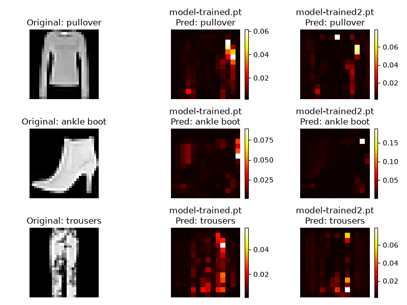
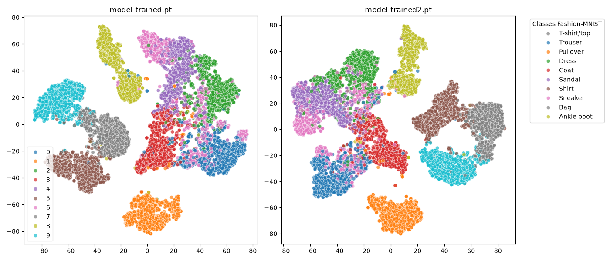

# Fashion-MNIST Architecture Exploration: ResNet & Attention

## 📌 Project Overview
This project goes beyond blindly chasing high accuracy scores. It is a deep architectural investigation into the physical limits of the Fashion-MNIST dataset (28x28 grayscale images). 

The goal was to understand *why* models typically get stuck at ~91% accuracy and why they struggle specifically with classes like `Shirt` (Class 6), `T-shirt/top` (Class 0), and `Pullover` (Class 2). To diagnose this, I built a custom ResNet-based architecture combined with a Multi-Head Attention mechanism to visualize exactly where the neural network is looking.

## 🧠 Architecture
The model is built from scratch using PyTorch and consists of:
1. **Initial Convolutional Layers:** For basic feature extraction.
2. **Residual Block:** To prevent vanishing gradients and allow for deeper feature learning without losing original input data.
3. **Multi-Head Attention (14x14 spatial grid):** Applied *before* flattening. By compressing the image to a 14x14 grid (instead of 7x7), the model retains enough spatial resolution for the Attention mechanism to pinpoint relevant clothing details.
4. **Fully Connected Layers:** For final classification.

## 📊 Key Findings & Visual Evidence

Through extensive testing and visualization, I discovered that the dataset's low resolution forces the model into specific "lazy" behaviors:

### 1. Edge Bias (Attention Maps)
I extracted the attention weights to generate heatmaps of the model's focus. The visualizations proved that the network almost entirely ignores internal textures (like the middle of a shirt or the length of a sleeve). Instead, it heavily fixates on outer contours, such as shoulders and necklines. 


### 2. Feature Space Overlap (t-SNE Visualization)
To understand the model's internal logic, I extracted the 256-dimensional feature vectors from the penultimate layer and reduced them to 2D using **t-SNE**. 



* The visualization reveals distinct, well-separated clusters for footwear (Ankle boots, Sneakers, Sandals).
* However, `Shirts`, `T-shirts`, and `Pullovers` form a massive, overlapping "galaxy" of points. This mathematically proves that in the latent space, lacking color and high-resolution textures, these items look almost identical to the model.

## 🚀 How to Run
1. Clone this repository:
   ```bash
   git clone https://github.com/xcoas/FashionMNIST-ResNet-Attention.git